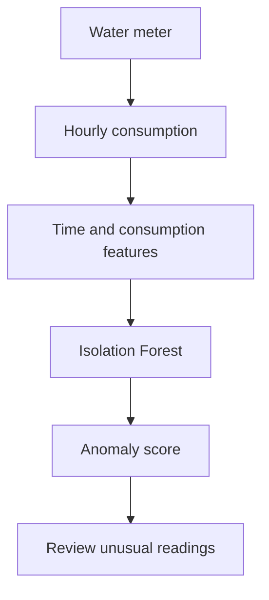

# SmartHome AI Guardian

Building AI course project

## Summary

SmartHome AI Guardian learns typical water consumption patterns and looks for unusual changes using machine learning. The idea is to help smart home users notice possible leaks or sensor problems without creating a separate automation for every situation.

## Background

I work with smart automation and use Home Assistant in my own smart home. One of my projects is reading a water meter with an ESP32-CAM. This made me think about what else I could do with the collected data instead of just displaying the current consumption.

A fixed threshold is not always useful. For example, a few litres of water during the night might be more unusual than much higher consumption during the day. Garden irrigation is another example where a large amount of water can be completely normal.

My idea is to learn the normal behaviour of a household and find unusual patterns. Water consumption is the first step because I already have a suitable use case. Small leaks can go unnoticed, but I do not have real-world statistics on how often this happens.

## How is it used?

The plan is to collect readings from Home Assistant and run the model locally. The user could see unusual consumption in a dashboard and decide if it needs attention. In the future it could also send a notification.

The target users are people who already have smart water meters or similar sensors, including tenants and homeowners. Other people living in the house are affected too, because their routines may be reflected in the sensor readings. Local processing and control over the stored data are therefore important.

At the moment the repository contains an offline Python demo, not a finished Home Assistant integration.



## Data sources and AI methods

The planned data source is the history of a Home Assistant water meter. For the demo, I use generated data instead of publishing private household readings. The script simulates 60 days of normal hourly water consumption for training and a separate 14-day development test with three deliberately added events (11 abnormal hours in total).

The algorithm is Isolation Forest from scikit-learn. It is an unsupervised machine learning method that identifies observations which are easier to isolate from the rest of the data. It does not need labelled examples of real leaks to train.

The model uses the following features:

- Hourly water consumption compared with the usual consumption at that time of day.
- The previous hour's relative consumption.
- A rolling average of the last three hours.
- Two cyclic time features, sine and cosine of the hour.

The hourly reference values are calculated only from the training data. The anomaly threshold is set using a contamination parameter of 0.025, which is a starting assumption rather than an estimate of the real leak frequency.

### Running the demo

Python 3.10 or newer is recommended. From the repository directory:

```bash
python -m pip install -r requirements.txt
python main.py
python -m unittest -v
```

The program creates `results.csv` with the hourly readings, known simulated anomaly labels, predicted flags and anomaly scores. A positive score indicates a flagged reading.

### First results

| Metric | Result |
| --- | ---: |
| Simulated test hours | 336 |
| Correctly flagged anomaly hours | 11 |
| False alarms (hours) | 11 |
| Missed anomaly hours | 0 |
| Precision | 50% |
| Recall | 100% |

These results are from the development simulation, not real household data. The feature design was improved after an initial run on the same scenario, so this is not an independent final evaluation. The tests check basic data generation, feature construction and model output. They do not prove that the system can reliably detect actual leaks.

## Challenges

An anomaly does not necessarily mean there is a leak. Guests, irrigation or a different daily routine could cause false alarms. A slow leak might also be missed, especially if it is already present in the training data.

The current demo assumes regular hourly readings and does not handle missing data, meter resets, OCR errors or changing seasons. It also needs validation using real data before it should be used for decisions. The model should not automatically shut off the water supply. The user should be able to review and dismiss warnings.

Water consumption can reveal when people are at home. The final version should keep data local, limit its retention and respect the privacy of everyone in the household.

## What next?

The next step would be to export real sensor readings from Home Assistant, handle missing data and compare the model with a simple fixed-threshold baseline. I would also like to test on a later period that was not used to develop the model and measure false alarms per day.

If that works well, the idea could become a Home Assistant integration with a simple dashboard, notifications and feedback from the user. Later it might also monitor electricity usage, temperatures and sensor failures.

## Acknowledgments

- [Building AI](https://buildingai.elementsofai.com/) by the University of Helsinki and MinnaLearn, for the course and project template.
- [Home Assistant](https://www.home-assistant.io/) and my experience with smart home automation, for the inspiration.
- [AI-on-the-edge-device](https://github.com/jomjol/AI-on-the-edge-device), for the water meter use case (no code reused in this demo).
- [scikit-learn](https://scikit-learn.org/) (BSD-3-Clause) and [NumPy](https://numpy.org/) (BSD-3-Clause), used as Python dependencies.
- ChatGPT assisted with the project draft, Python prototype and documentation.

No private household data or third-party images are included in the demo.
